  

   

  
  
  

 

  

 

   
  <b>Languages</b>
    
  
    
  <b>Web &amp; Design</b>
    
  
    
  <b>Tools</b>
    
  
    

   
  
    

   
  
  
  
  
  
    
  
    

  <!-- Restore the <picture> with snake-dark.svg once the snake workflow has run -->
  

